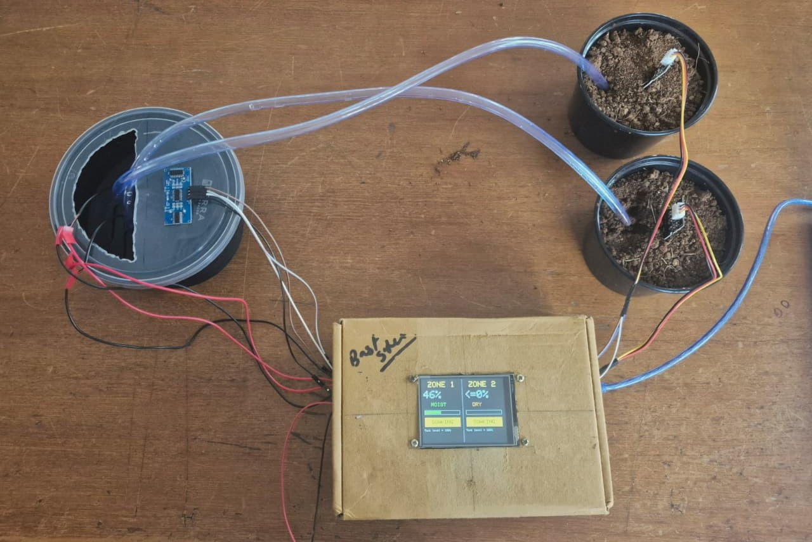
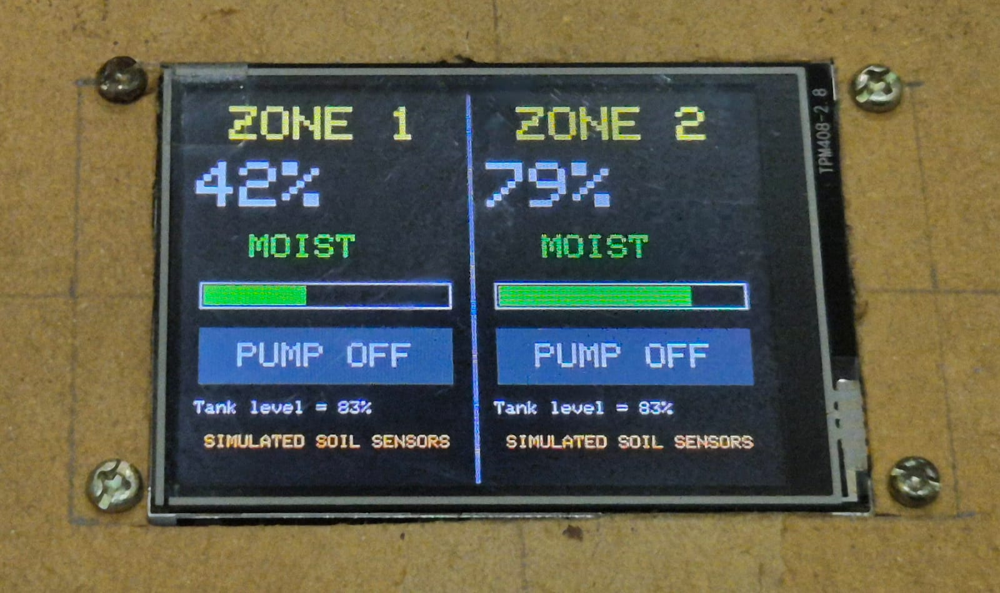
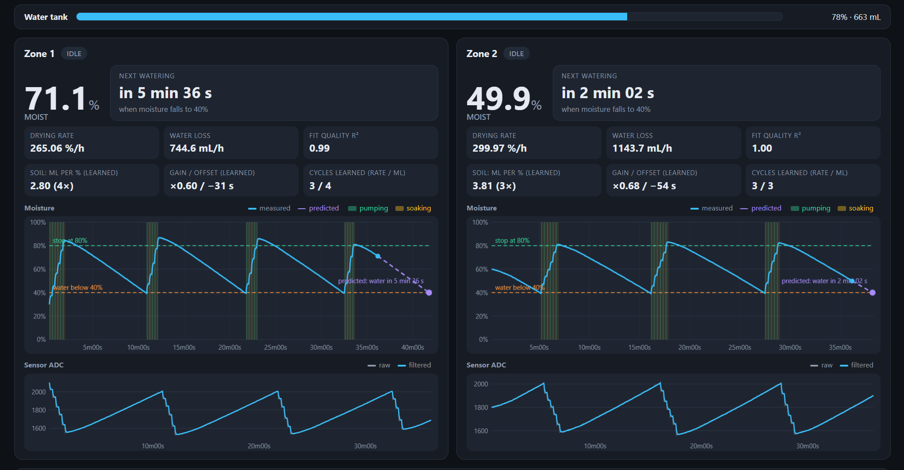
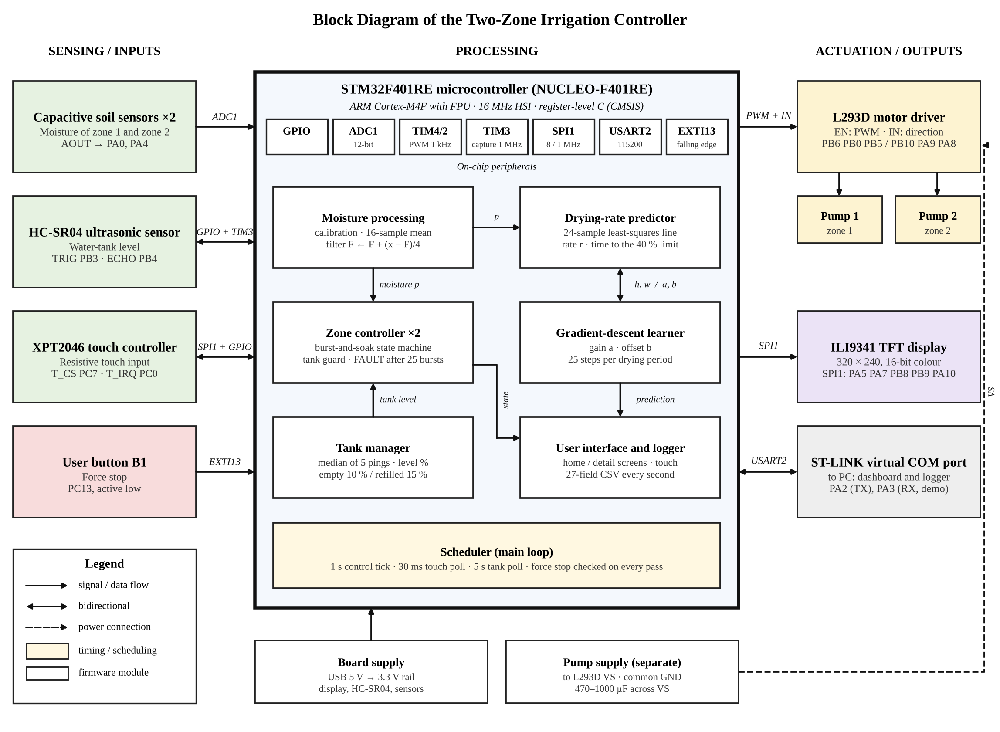
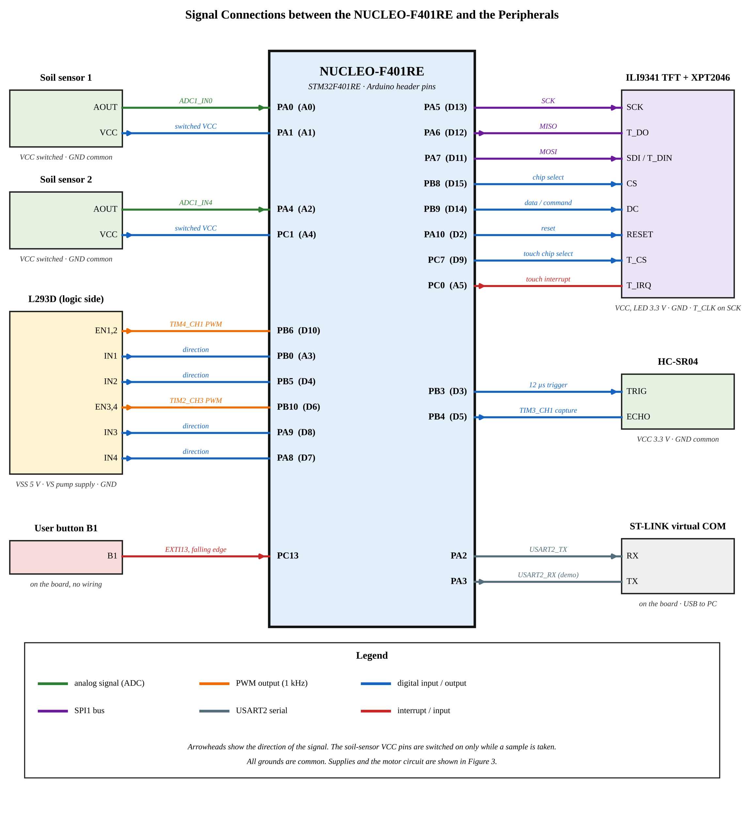
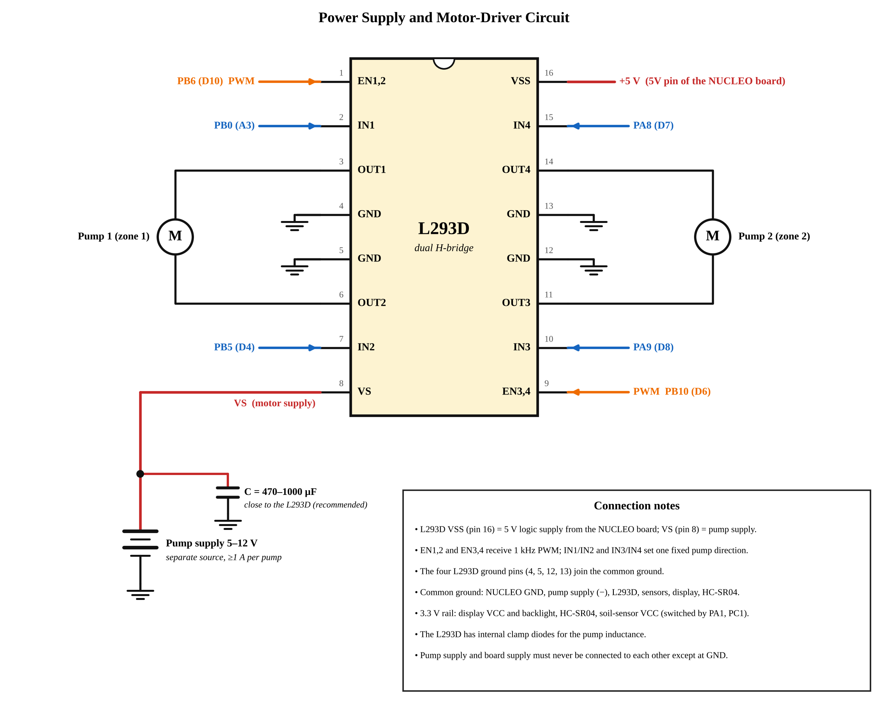
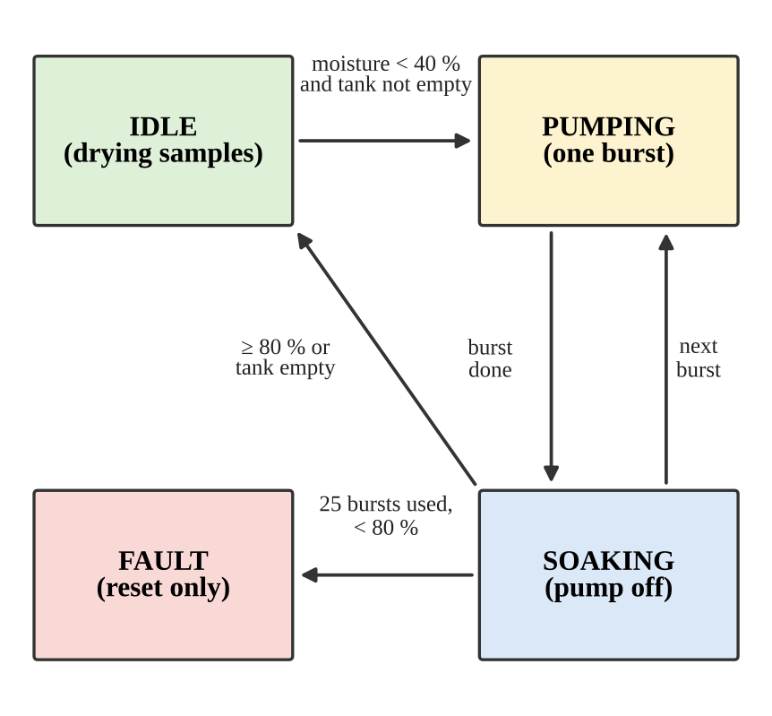
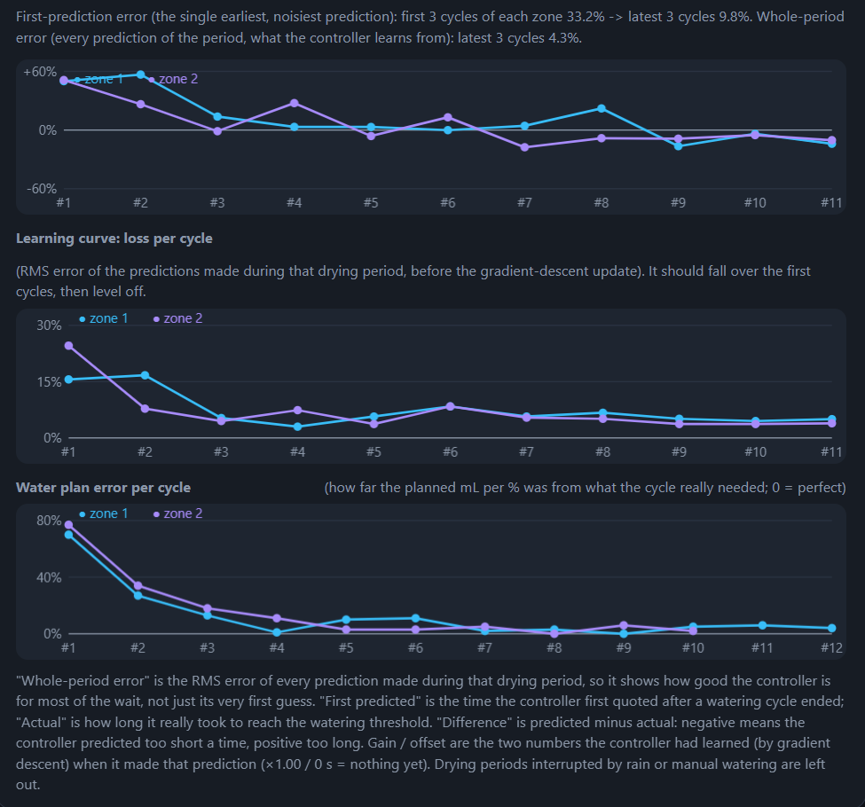

# Adaptive Multi-Zone Irrigation Controller (STM32)

A two-zone soil irrigation controller on an **STM32 NUCLEO-F401RE** (Cortex-M4F), written bare-metal at register level. Each zone waters in bursts between a low and a high moisture limit, and the controller **predicts when each zone will need water next**. It improves that prediction on the microcontroller itself, using gradient descent over previous drying cycles.

Course project for **23ELC302, Embedded Systems Design using ARM**, B.Tech. Electrical & Computer Engineering, Amrita School of Engineering, Coimbatore (November 2026). The full write-up is in [`docs/project_report.docx`](docs/project_report.docx).

<p align="center">
  
  
</p>

## Features

- **Two independent zones**, each with its own capacitive soil sensor, pump, calibration, thresholds and state machine.
- **Burst-and-soak watering.** Short pump bursts with a soak period between them, so the lagging sensor does not cause overshoot.
- **Drying-rate prediction.** A least-squares line over a sliding 24-sample window gives the time until the moisture reaches the watering threshold.
- **On-chip learning.** A gain and an offset per zone are learned by gradient descent (25 steps per drying period) and correct the prediction. It also learns how many mL of water raise the moisture by 1 %.
- **Rain and manual-watering detection.** Those periods are excluded from learning.
- **Safety.** Tank-empty lockout (HC-SR04), a burst limit that triggers FAULT, and a force-stop button on an EXTI interrupt.
- **ILI9341 touch UI.** Home screen with both zones, and a detail screen per zone.
- **Web dashboard.** Live charts, the prediction explained step by step, learning curves and a prediction-vs-actual table, over Web Serial.



## Repository layout

```
firmware/
  irrigation_real.c    Field configuration: real soil sensors, real timing
  irrigation_demo.c    Demo configuration: simulated soil, timings shortened to seconds
dashboard/
  index.html           Single-file web dashboard (Chrome / Edge, Web Serial)
docs/
  project_report.docx  Full project report
  images/              Diagrams, screenshots, plots
```

## Hardware

| Part | Use |
|---|---|
| NUCLEO-F401RE | MCU board (STM32F401RE) |
| 2x capacitive soil-moisture sensor | Analog moisture input, powered from a GPIO only while sampling |
| L293D dual H-bridge + 2 DC pumps | Pump drive (PWM on the enable pins), separate pump supply, common GND |
| ILI9341 TFT with XPT2046 touch | UI, both on SPI1 |
| HC-SR04 | Water-tank level |
| User button B1 (PC13) | Force stop |

### Pin map

| Function | Pin |
|---|---|
| Zone 1 sensor AOUT / VCC | PA0 / PA1 |
| Zone 1 pump: EN (TIM4_CH1) / IN1 / IN2 | PB6 / PB0 / PB5 |
| Zone 2 sensor AOUT / VCC | PA4 / PC1 |
| Zone 2 pump: EN (TIM2_CH3) / IN3 / IN4 | PB10 / PA9 / PA8 |
| SPI1 SCK / MISO / MOSI | PA5 / PA6 / PA7 |
| TFT CS / DC / RESET | PB8 / PB9 / PA10 |
| Touch CS / IRQ | PC7 / PC0 |
| HC-SR04 TRIG / ECHO (TIM3_CH1 capture) | PB3 / PB4 |
| Serial (USART2 TX, ST-Link virtual COM, 115200) | PA2 |
| Force-stop button (EXTI13) | PC13 |

The header comment in each `.c` file is the authoritative copy of this table.

<details>
<summary>Block diagram, wiring and state machine</summary>






</details>

## Build and flash

The firmware is a replacement for the CubeMX-generated `main.c`. The STM32 HAL is used only for start-up code and the 1 ms SysTick.

1. In STM32CubeIDE, create a project for **NUCLEO-F401RE** with default settings.
2. Replace `Core/Src/main.c` with **one** of the two files in `firmware/` (see below).
3. Build and flash.
4. Open the ST-Link virtual COM port at 115200 baud if you want to see the serial log.

| File | Use it for |
|---|---|
| `irrigation_demo.c` | Showing the behaviour in minutes. A software soil model replaces the sensor; soak is 15 s and samples are every 10 s. The tank sensor is still real. |
| `irrigation_real.c` | Real soil. Samples every 10 min, a 1 h settling time, a 4 h fit window. |

**Before using `irrigation_real.c`:** recalibrate `adc0` and `adc100` per zone in the `zcfg[]` table. Zone 2 currently has the same numbers as zone 1. Also set `TANK_FULL_MM`, `TANK_EMPTY_MM` and `TANK_CAP_ML` for your own tank.

On power-up the firmware runs a 3-second pump test and a 3-touch screen calibration. Both can be switched off with `PUMP_TEST_AT_BOOT` and `TS_CAL_AT_BOOT` in the settings block.

## Dashboard

1. Flash the firmware and keep the board connected by USB.
2. Download `dashboard/index.html` and open it in **Chrome or Edge**. Web Serial is not available in Firefox or Safari.
3. Click **Connect board** and pick the ST-Link COM port. Close any other serial terminal first.
4. Optionally use **Rain Z1 / Rain Z2** to send a simulated rain event (demo firmware only), **Save CSV** to export, and **Load log file** to replay a saved log.

The dashboard parses the `CSV,...`, `SAMP,...` and event lines that the firmware prints, so it works with either firmware file.


## How the prediction works

1. While a zone is idle, the controller stores a moisture sample every few minutes (last 24 kept).
2. It fits a straight line through them. The slope is the drying rate in %/h.
3. It extends the line to the watering threshold: `time = (moisture now - threshold) / rate`.
4. It applies two learned numbers per zone, a **gain** on the rate and a start-up **offset**, found by gradient descent from earlier cycles. The weight of the correction fades as the sample window fills.
5. After each watering, every stored prediction is compared with the real time that was left, and the gain and offset are updated.

| Result (demo, 40 drying periods from the 4th on) | Value |
|---|---|
| Mean period RMS error, both zones | 6.9 % |
| Maximum period RMS error | 10.4 % |
| RMS error of first predictions | 8.0 % |

Field data from the real sensor shows a steady drying rate of about **0.40 %/h** (27.8 h log). A real cycle therefore takes days, which is why the demo configuration exists.



## Limitations

- The straight-line model cannot anticipate temperature or airflow changes. The learner adapts over a few cycles.
- The learned values apply to one zone and one soil and are not shared between zones.
- Rain is detected only as a rise of more than 1 % between samples, so slow wetting is missed.
- The learner has been evaluated in the simulated-soil demo. Weeks of real-soil operation are still needed.
- Future work: both sensors calibrated in their own soil, pump delivery verified, temperature in the drying model, a flow sensor, a watchdog, wireless reporting.

## Authors

- Abhinav Pradeep Menon

Amrita Vishwa Vidyapeetham, Coimbatore.

## License

[MIT](LICENSE)
